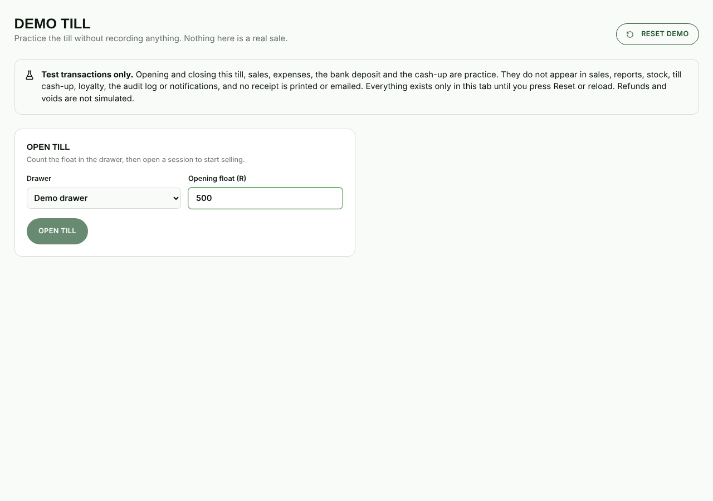
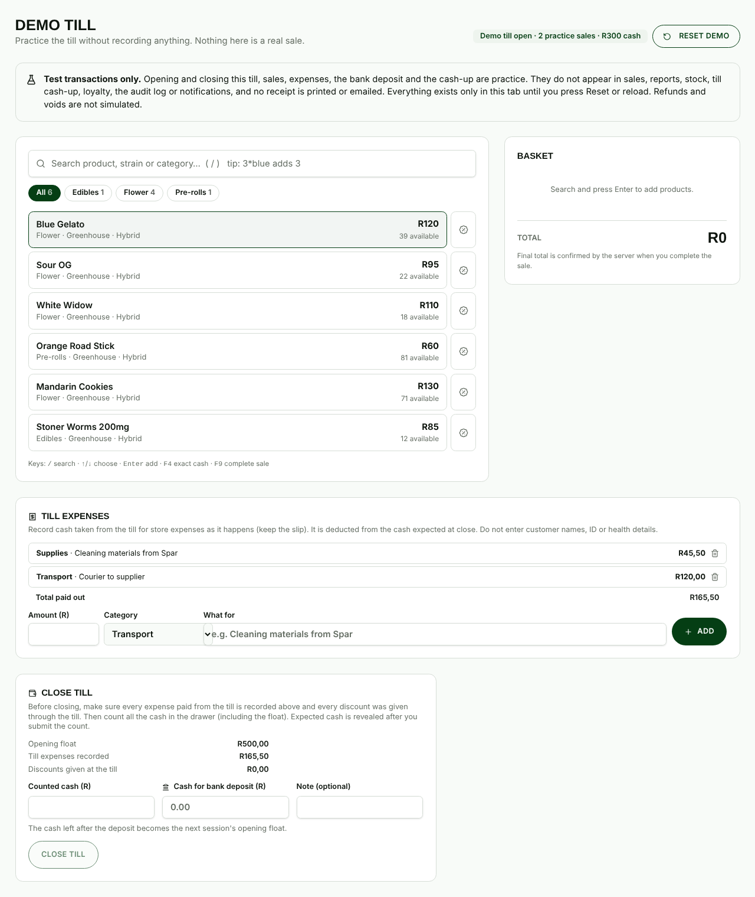
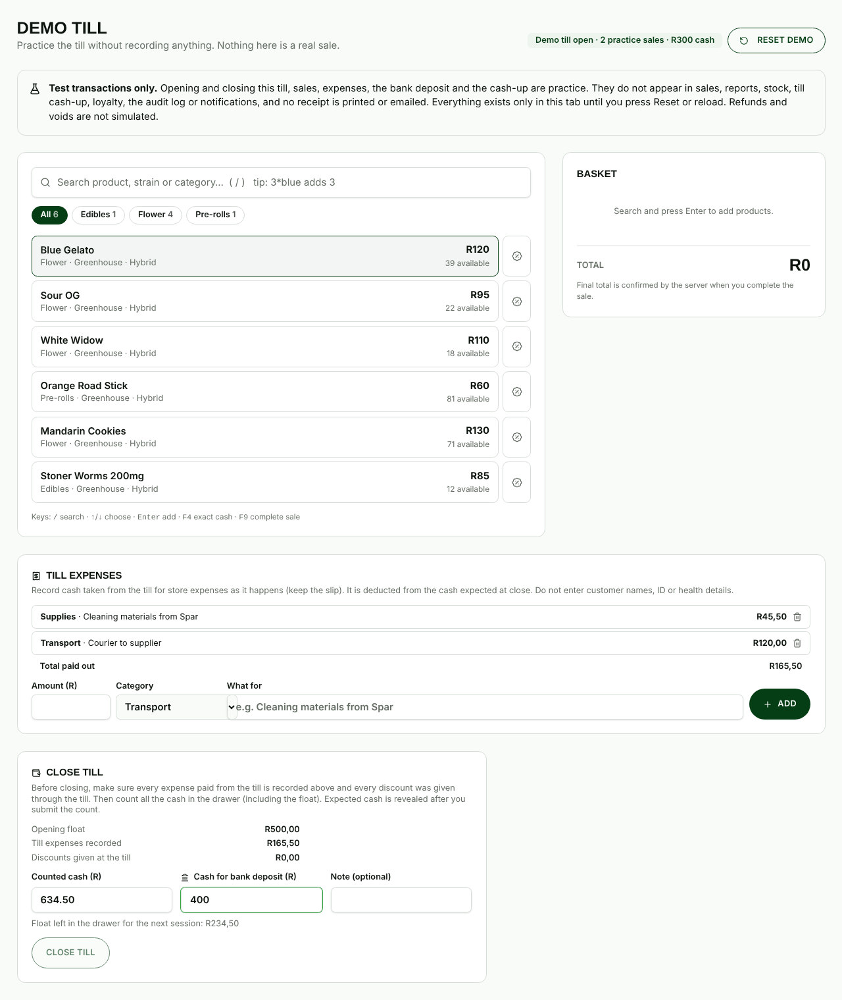
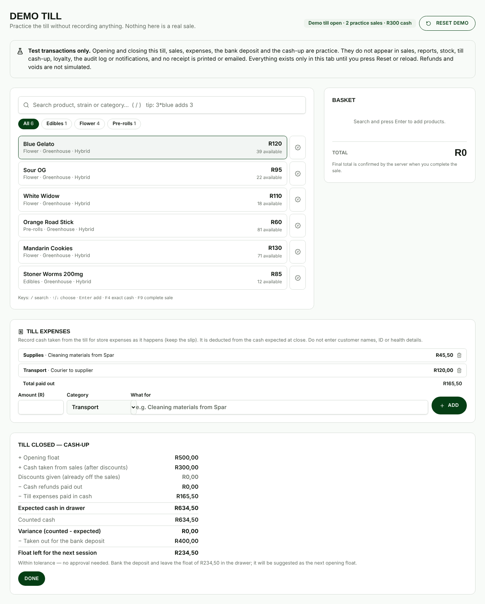

# Till expenses, bank deposit and cash-up (how to record them)

For cashiers, managers and admins. The screenshots are from the **Demo till** (Admin → Demo till), which has the same
screens as the real till (Admin → POS) but records nothing. Amounts are examples.

## The day in four steps

### 1. Open the till

Admin → **POS** → choose the drawer → check the **Opening float** → **Open till**.
The float is suggested for you: it is the cash left in the drawer after yesterday's bank deposit. Count the drawer and
correct the figure if it differs.

### 2. Record every expense paid from the till cash, as it happens

Under **Till expenses**: enter the **Amount**, pick a **Category**, write **What for** (for example "Cleaning materials
from Spar") and press **Add**. Keep the slip. Each expense appears in the list and in **Total paid out**.

- The money is taken off the cash the till expects at the end of the day, so the count still balances.
- Added by mistake? Press the bin icon and give a reason (the expense is removed and the removal is recorded).
- Never type a customer's name, ID or any health detail into the description.

### 3. Close the till: count the cash and enter the bank deposit

Under **Close till**:

1. Count **all** the cash in the drawer, including the float, and enter it as **Counted cash**.
2. Enter **Cash for bank deposit**: the cash you are taking out to bank. Leave it blank (0) if nothing is going to the bank.
3. The screen shows **Float left in the drawer for the next session** (counted minus deposit). That cash stays in the drawer.
4. Press **Close till**.

The deposit cannot be more than the cash counted. The expected cash is hidden until you submit the count, so count first.

### 4. Read the cash-up

After closing, the screen lays out how the day adds up:

| Line                                  | Meaning                                                      |
| ------------------------------------- | ------------------------------------------------------------ |
| Opening float                         | Cash in the drawer at the start                              |
| + Cash taken from sales               | Cash payments from sales, after discounts                    |
| − Cash refunds paid out               | Cash handed back to customers                                |
| − Till expenses paid in cash          | Everything recorded under Till expenses                      |
| **= Expected cash in drawer**         | What should be in the drawer                                 |
| Counted cash                          | What you counted                                             |
| **Variance**                          | Counted minus expected (red if not zero)                     |
| − Taken out for the bank deposit      | The deposit you entered                                      |
| **= Float left for the next session** | Counted minus deposit; suggested as tomorrow's opening float |

A variance of **R10.00 or less** (over or short) needs no approval. A bigger variance is held for a manager to approve
with a reason (POS → Variance approvals). Take the deposit to the bank and leave the float in the drawer.

## Worked example (the screenshots)

Float R500.00 + cash sales R300.00 − expenses R165.50 (R45.50 + R120.00) = **expected R634.50**. Counted R634.50, so the
variance is R0.00. Bank R400.00, leaving **R234.50** as the next float.

## Practising

Managers and admins can run the whole day without recording anything under **Demo till**: open the till, sell, add
expenses, close with a deposit and read the cash-up. **Reset demo** starts again. Refunds and voids are not simulated.
